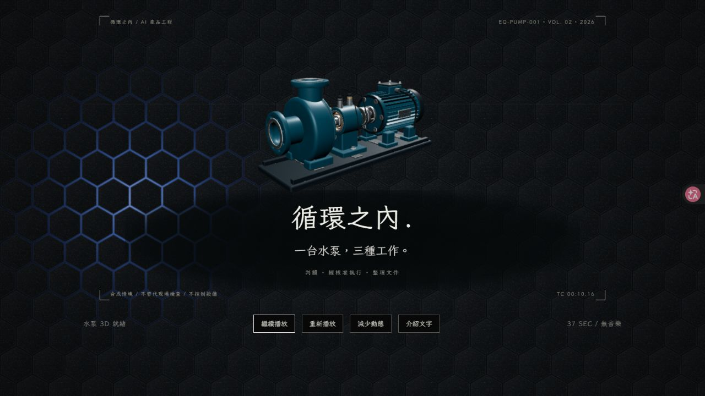
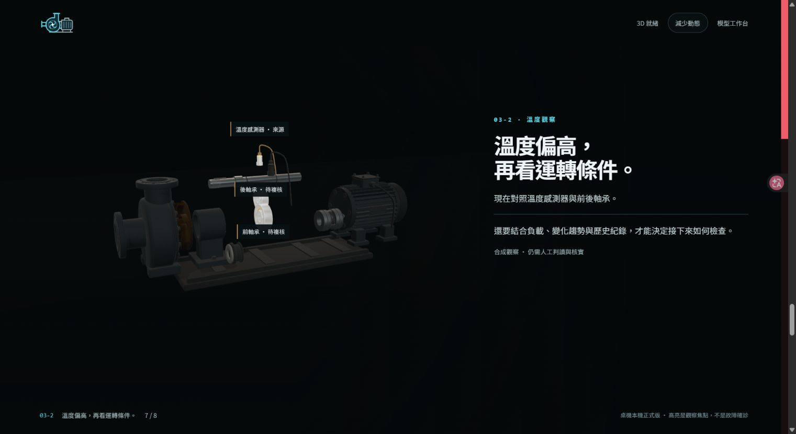

# Pump Portfolio Showcase｜循環水泵互動展示

A desktop-first 3D portfolio presentation: a seven-second assembly opening, a 37-second film, and an eight-slice scroll narrative explaining three independent AI engineering products.

用一台循環水泵，讓第一次接觸作品的訪客理解：**作品一判斷、作品二經核准執行、作品三整理文件**。本站負責介紹，不執行推論、不建立工單、不接收私人文件。

## 正式版與展示方式

| 項目 | 狀態 |
| --- | --- |
| B 影片入口 | 0.3.0，按播放後自動跑完，片尾「深入了解」進入 A |
| A 捲動介紹 | 0.4.0，桌機本機正式版，八個切片，上下捲動可回看 |
| 核心產品 | 位於另外三個儲存庫；介紹站不呼叫其 API |
| 公開交付 | 原始碼、必要素材、測試、鎖檔、授權與去識別畫面 |





## 互動內容

- B：中央 X 光式透視，433 個展示 mesh 在左右等待區縮小排列，逐件移動、放大並於七秒內定位；不是廠商 CAD、真實製造清單或安全裝配程序。
- B：原色水泵、文字與簡圖各占一半；蜂窩霧黑背景的單束藍白／深藍流光自動運行，影片暫停不等於背景停止。可暫停、繼續、重播、查看八段文字稿及減少動態。
- A：00 三作品說明 → 主角 → 水路總覽／供水／回水 → 震動／溫度／安全觀察。轉場由捲動驅動，不以三個訊號按鈕切換。
- A：右側貼邊紅條顯示距離下一片的進度；逐字浮現支援回捲重播，降低動態／靜態模式保留可閱讀文字。
- A：震動與溫度以爆炸圖、高亮相關位置、低暗無關位置解釋「需要查哪裡」，不把觀察線索當成故障確診；安全片明示未發現危害不等於安全認證。
- A 片尾連到三個獨立作品介紹站；附加模型工作台及舊活動入口保留，歷史候選頁不是本輪正式主入口。

## 輸入、處理與輸出

輸入是播放／捲動／低動態選項；處理由可逆時間契約驅動 3D 姿態、材質副本與逐字文字；輸出是視覺說明、文字替代與作品導覽。資料全部為專案自行製作的合成展示，沒有線上設備訊號或控制指令。

## 在本機執行

需求：Node.js 24、pnpm 11、支援 WebGL 的桌機瀏覽器。依賴初次安裝需要套件來源網路；模型、圖示與字型隨原始碼提供。

```powershell
git clone https://github.com/bdf10019/pump-portfolio-showcase.git
cd pump-portfolio-showcase
pnpm install --frozen-lockfile
pnpm test
pnpm build:reel
pnpm build:intro
```

分別在兩個終端執行：

```powershell
pnpm preview:reel
# 另一個終端：pnpm preview:intro
```

B：<http://127.0.0.1:4172/reel.html?v=0.3.0>；A：<http://127.0.0.1:4173/intro-candidate.html?v=0.4.0#intro>。

附加工作台需要另外執行 `pnpm build`、`pnpm preview`，位址 4177；A 頁尾的 4178／4179／4180 需從對應作品的 showcase 執行 `pnpm install --frozen-lockfile`、`pnpm build`、`pnpm preview`。沒有自動探查或啟動訪客的電腦。Ctrl+C 停止自己的預覽。

## 結構與驗收

`src` 是時間／捲動契約、場景與可重建模型；`public/assets` 是自製 GLB、具名零件契約、字型及授權；`tests` 涵蓋排列、終點、回播、材質隔離、時間邊界、紅條、文字替代與正式狀態。兩份 Vite 設定分開產生 dist-reel／dist-intro，不提交依賴或建置目錄。

本機正式驗收曾通過 27 檔／237 項測試、TypeScript 與 A／B 建置，Chrome 實跑 B 片尾→A→三介紹站、低動態、回捲及中途重新整理。公開來源副本的當次重跑另見 [公開交付驗證](docs/PUBLIC_VERIFICATION.md)，不要把歷史成績當作遠端 CI 結果。

限制：只以桌機 Chrome 為本輪驗收；未測 FPS、長任務、記憶體、跨瀏覽器、手機或獨立真人理解。A／B 的 3D chunk 大於 500 kB 警告仍存在；小件不保證七秒內逐件可讀。字型按 OFL、Three.js 按 MIT 保留 notice；原創素材可作公開作品展示，不自行擴張成其他再授權，見 [授權說明](LICENSE_INFORMATION.md)。

## 公開範圍與資料安全

此儲存庫是 2026-10-10 整理的公開來源快照，不包含舊 Git 歷史、帳號／Session、正式 SQLite、上傳文件、原始複核證據、工單內文、備份、模型權重、私有引擎或完整本機 reports。測試內固定密碼／角色是**合成測試資料**，不會植入產品帳號。執行後建立的私人狀態由 .gitignore 排除，請勿強制加入 Git。

GitHub 上公開的是原始碼與文件；本次沒有啟用 GitHub Pages，也沒有公開核心後端服務。README 中的 127.0.0.1 只適用於執行者自己的電腦。既有鎖版依賴與授權摘要保留，不宣稱完整供應鏈、資安或生產部署認證。

[公開交付契約](docs/PUBLIC_RELEASE.md) · [原產品操作資料](LOCAL_PRODUCT_GUIDE.md)

## 系列作品 / Portfolio

同一個合成情境：`EQ-PUMP-001` 循環水泵。三個產品**各自運作**，不是已串接的自動維修系統，也不控制真實設備。

| 儲存庫 | 英文｜中文名稱 | 責任 |
| --- | --- | --- |
| [pump-portfolio-showcase](https://github.com/bdf10019/pump-portfolio-showcase) | Pump Portfolio Showcase｜循環水泵互動展示 | 影片式入口與捲動式 3D 說明 |
| [ai-model-service-mlops](https://github.com/bdf10019/ai-model-service-mlops) | AI Model Service & MLOps｜AI 模型服務與維運治理 | 判斷資訊與管理模型 |
| [mcp-tool-governance](https://github.com/bdf10019/mcp-tool-governance) | MCP Tool Governance｜MCP 工具整合與授權治理 | 經授權及核准執行工具 |
| [multimodal-document-review](https://github.com/bdf10019/multimodal-document-review) | Multimodal Document Review｜多模態文件理解與人工複核 | 對照來源並整理文件 |
